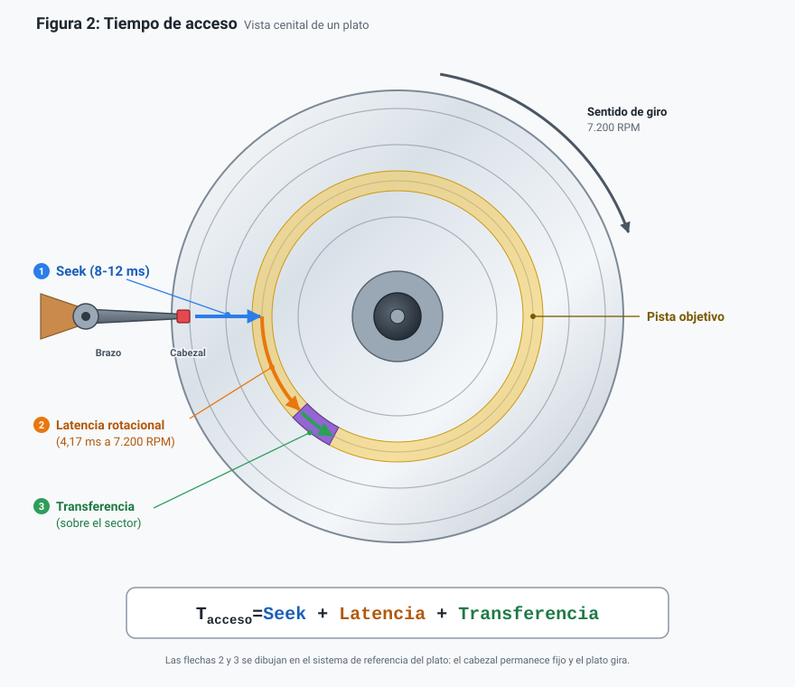
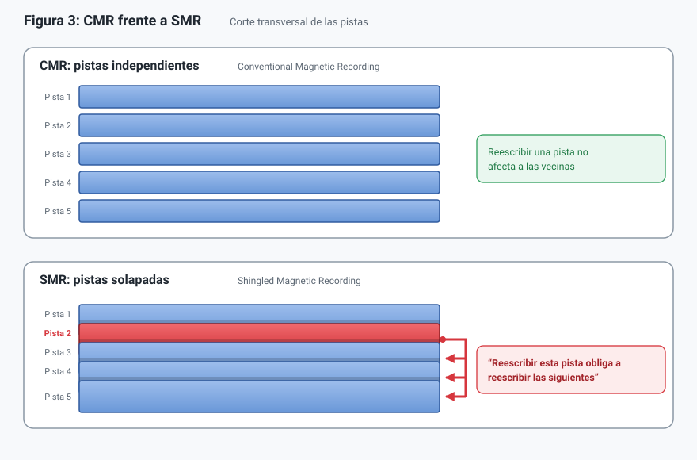
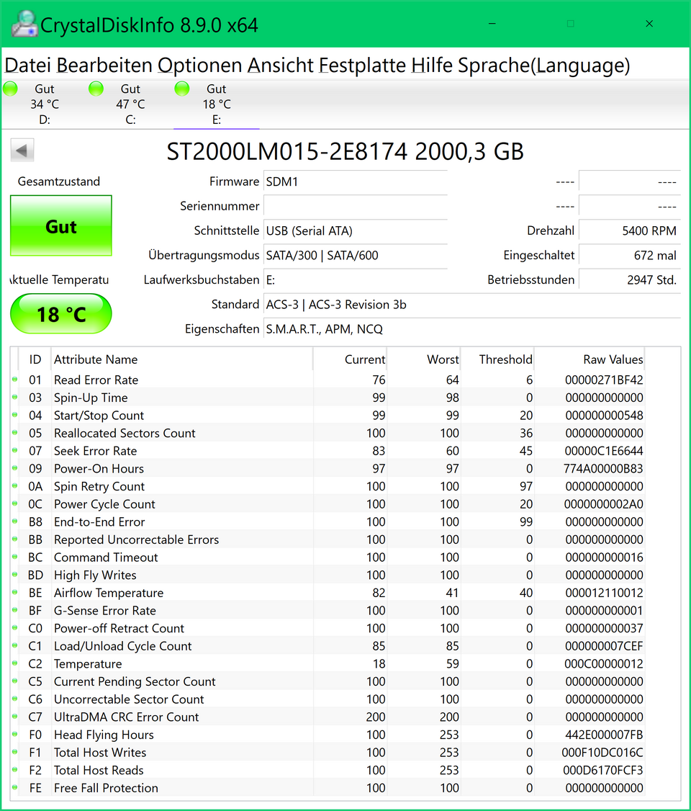

# Puzzle UT2 · Pieza 04: HDD
Grupo: Maisara Aldana (@maiswth) · Morena Macias (@M0ren42)

## 1. Qué es y qué función cumple en el sistema
- **Definición:** Un disco duro es un dispositivo de almacenamiento **no volátil** que conserva los datos aunque el ordenador esté apagado. Utiliza platos magnéticos giratorios y cabezales para leer y escribir información.

En el sistema es el **almacenamiento secundario**, guarda el sistema operativo, los archivos y las copias de seguridad, y entrega datos a la RAM cuando se necesitan.

#### Jerarquía de memoria y E/S
- **Definición:** es la forma en que se organizan los diferentes tipos de memoria de un ordenador según su velocidad, capacidad y coste. Las memorias más rápidas utilizan tecnologías más costosas y necesitan estar muy cerca del procesador. **Cada nivel es caché del inferior**.

| Nivel | Latencia típica | Capacidad típica | Papel |
|---|---|---|---|
| Registros + caché L1-L3 | < 50 ns | KB-MB | Datos que usa la CPU ahora |
| RAM | ~100 ns | GB | Programas y datos en uso |
| SSD | ~0,1 ms | 0,5-4 TB | Permanente y rápido |
| **HDD** | **5-15 ms** | **1-30+ TB** | Permanente y barato por TB |

#### Cuándo sigue compensando un HDD
Aunque los SSD ofrecen menor IOPS, los HDD siguen siendo útiles para almacenar grandes cantidades de datos por su menor coste por TB. Su evolución busca aumentar la densidad de almacenamiento: **guardar más información en el mismo espacio**.
- **Conclusión:** HDD cuando importa la capacidad por euro; SSD cuando importa la velocidad. Muchos equipos combinan ambos: SSD para el sistema y HDD para los datos.

## 2. Como funciona por dentro

##### *Figura1. Interior de un HDD de 3,5": el motor hace girar los platos y el brazo coloca el cabezal sobre la pista; la placa controladora (PGB) gestiona el caché y la interfaz.*

- **Platos:** son los discos que guardan los datos mediante magnetismo, cubiertos de material magnético. En su superficie se organizan los datos en circunferencias concéntricas llamadas pistas (*tracks*), y cada pista se divide en **sectores** (512 B o 4 KiB), la unidad mínima de lectura y escritura. Pueden utilizarse ambas caras.
- **Cabezales de lectura:** escriben modificando la orientación magnética de pequeñas regiones para representar los datos y leen detectando variaciones magnéticas.
- **Brazo actuador:** desplaza los cabezales hasta la pista donde se encuentran los datos.
- **Motor del eje (*spindle*):** hace girar los platos a velocidad constante.
- **Placa controladora (PCB):** electrónica situada en la cara inferior del disco; ejecuta el firmware, controla el motor y el brazo, y se comunica con el equipo por la interfaz.

---

## 3. Características, unidades y cómo se miden

#### Tiempo de acceso
Es el tiempo necesario para localizar y leer datos.

$$T_{\text{acceso}} = T_{\text{seek}} + T_{\text{rotacional}} + T_{\text{transferencia}}$$

##### *Figura 2. Los tres componentes del tiempo de acceso. A 7.200 RPM la espera rotacional media es de 4,17 ms.*

| Característica | Unidad | Valor típico | Qué significa y cómo se obtiene |
|---|---|---|---|
| Velocidad de giro | RPM | 5.400 / 7.200 | Vueltas por minuto. Ficha técnica. |
| Tiempo de búsqueda (*seek*) | ms | 8-12 | Tiempo del brazo hasta la pista. Ficha técnica. |
| Latencia rotacional | ms | 4,17 (7.200 RPM) | Media vuelta: `60.000 / RPM / 2`. A 5.400 RPM, 5,56 ms. |
| Tasa de transferencia sostenida | MB/s | 150-250 | Velocidad en lectura continua (mayor en el exterior del plato). Benchmark (CrystalDiskMark, `fio`). |
| IOPS aleatorios | ops/s | ~80-100 | ~ 1 / (seek + latencia). Un SSD supera las decenas de miles. |
| Fiabilidad (MTBF) | horas | ~1.000.000 | Estimación estadística de una población. AFR ~ 8.760 / MTBF ~ 0,88 %/año. |

**Ejemplo:** a 7.200 RPM con seek de 8 ms, un acceso aleatorio tarda aprox. 12 ms
(8 + 4,17), es decir, unos 80 IOPS. Por eso el HDD sufre con muchos archivos pequeños
y rinde bien con archivos grandes y continuos.

#### RPM (Revolutions Per Minute) 
Indica cuántas vueltas completas realizan los platos de un disco duro en un minuto; las velocidades habituales con 5.400 y 7.200 RPM; a mayor RPM menor latencia rotacional, esto se traduce en + operaciones - tiempo pero aumentan el ruido, calor y el consumo de energía.

#### Acceso por bloques
La RAM permite acceder directamente a posiciones individuales de memoria direccionables por bytes. Sin embargo, los dispositivos de almacenamiento suelen trabajar mediantes bloques de datos: el disco lee y escribe siempre sectores completos.

#### Memoria caché
- **Definición:** es una pequeña memoria temporal integrada en el disco duro (normalmente DRAM). Su función es almacenar datos durante un tiempo para acelerar determinadas operaciones de lectura y escritura. 
En la lectura guarda temporalmente los datos recién solicitados para poder entregarlos rápidamente si vuelven a pedirse, y en la escritura almacena los datos mientras el firmware los organiza y agrupa antes de registrarlos en los platos, reduciendo los tiempos de espera.

#### MTBF (Mean Time Between Failures)
- **Definición:** estimación estadística de la fiabilidad de un dispositivo, que indica el tiempo medio entre averías y se expresa normalmente en horas. No permite predecir cuándo va a fallar un disco concreto.

## 4. Tipos, evolución y estándares actuales
**Tecnología de grabación**

| | CMR | SMR |
|---|---|---|
| Pistas | Una junto a otra, sin solaparse | Solapadas parcialmente |
| Densidad | Menor | Mayor |
| Escritura | Constante y predecible | Lenta en aleatoria: reescribe pistas vecinas |
| Uso recomendado | NAS, RAID, uso mixto | Copias y archivo (escritura secuencial) |

##### *Figura3. CMR (pistas independientes) frente a SMR (pistas solapadas): mas densidad a costa de reescrituras.*

**Factor de forma e interfaz** (son independientes: cualquier tamaño puede usar SATA o SAS)

| | Uso típico | Notas |
|---|---|---|
| 3,5" | Sobremesa, NAS | Alimentación 5 V y 12 V |
| 2,5" | Portátiles, externos | Normalmente 5 V (USB) |
| SATA (6 Gb/s) | Doméstico y NAS | Barato. Funciona en controladora SAS |
| SAS (12 Gb/s*) | Servidores | Fiabilidad y alta disponibilidad. **No** funciona en SATA convencional |

Evolución: desde el IBM RAMAC (1956, ~ 5 MB) pasando por IDE/PATA, SATA, la grabación perpendicular, el helio y el SMR, hasta HAMR/MAMR (más de 30 TB). El objetivo es siempre el mismo: guardar más información en el mismo espacio.

## 5. Un modelo real: Seagate IronWolf 4 TB (ST4000VN006)

Es un HDD diseñado para sistemas NAS, adecuado para compartir archivos y realizar copias de seguridad. (enlace a la ficha del fabricante)

| Dato de la ficha | Qué significa | ¿Es bueno? ¿Para qué uso? |
|---|---|---|
| Capacidad: 4 TB | Cantidad de información que puede almacenar. | Adecuada para documentos, vídeos y copias de seguridad. |
| Formato: 3,5 pulgadas | Tamaño físico del disco. | Apropiado para NAS y sobremesas con una bahía compatible. |
| Interfaz: SATA 6 Gb/s | Estándar de conexión y velocidad máxima del enlace, no de lectura del disco. | Permite conectarlo a equipos y NAS compatibles con SATA. |
| Velocidad de giro: 5.400 RPM | Los platos dan 5.400 vueltas por minuto. | Adecuada para almacenamiento y copias de seguridad. |
| Caché: 256 MB | Memoria temporal utilizada para gestionar datos. | Ayuda a gestionar las transferencias, pero no aumenta la capacidad permanente. |
| Grabación: CMR | Las pistas se escriben sin solaparse. | Ofrece escrituras más predecibles, adecuadas para NAS y RAID. |
| Transferencia sostenida máxima: 202 MB/s | Máxima velocidad sostenida indicada por el fabricante; puede variar según las condiciones. | Adecuada para transferir archivos grandes y realizar copias de seguridad. |
| Funcionamiento: 24/7 | Diseñado para trabajar de forma continua. | Adecuado para un NAS encendido todo el día. |

Este modelo prioriza el almacenamiento continuo y las copias de seguridad en un NAS, más que el máximo rendimiento.

## 6. Averías típicas y errores al elegirlo o instalarlo

| Situación | Síntoma | Qué hacer |
|---|---|---|
| Fallo mecánico (motor/cabezales) | No gira, golpes o clics repetitivos* | Copia de seguridad inmediata si aún es accesible; no seguir usándolo |
| Errores de lectura/escritura | Archivos inaccesibles, avisos SMART | Diagnóstico con 'smartctl' o CrystalDiskInfo |
| Cables mal conectados | El equipo no detecta el disco | Revisar datos y alimentación con el equipo apagado y desconectado |
| Puerto SATA desactivado | No aparece | Comprobar BIOS/UEFI |
| Disco nuevo sin preparar | No aparece en el sistema | Inicializar, particionar y formatear **el disco correcto** |
| Mala elección | SMR en RAID/NAS; disco de sobremesa en uso 24/7; SAS en puerto SATA | Elegir CMR y modelo para NAS; comprobar compatibilidad |

#### SMART (Self-Monitoring, Analysis and Reporting Technology) 
- **Definición:** tecnología que permite al disco registrar indicadores (temperatura, sectores reasignados y
pendientes, errores de lectura) que ayudan a detectar deterioro, pero **no garantiza
avisar antes de un fallo**.

##### *Figura 4. Lectura SMART de un HDD Seagate de 2 TB en CrystalDiskInfo. ¿ Temperatura, ¿ sectores reasignados, ¿ sectores pendientes.* 

Si los sectores reasignados o pendientes crecen, los prioritario es proteger los datos: hacer copia de seguridad si el disco todavía permite acceder a ellos y comprobar su estado antes de seguir utilizándolo.

## Fuentes
1. Figura 4: [https://commons.wikimedia.org/wiki/File:20210304_17_01_38-CrystalDiskInfo_8.9.0_x64_cens.png].*
2.
3.

## Uso de IA
Se a utilizado la IA para generar los archivos .pvg y reestructurar el documento para no repetir información  y está quede bien organizada y sin errores. (Claude y Perplexity)
