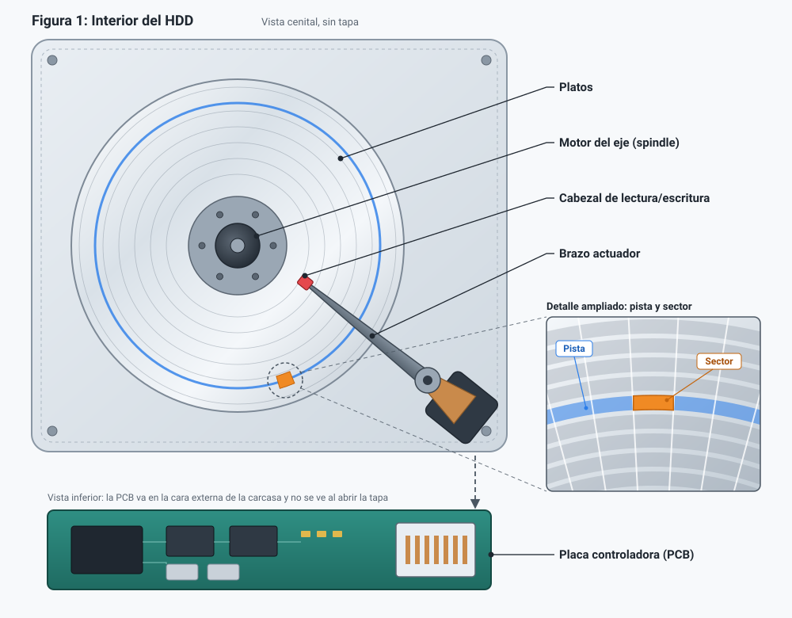

# Puzzle UT2 · Pieza 04: HDD
Grupo: Maisara Aldana (@maiswth) · Morena Macias (@M0ren42)

## 1. Qué es y qué función cumple
Un **HDD** es un dispositivo de almacenamiento **no volátil:** conserva los datos sin corriente mediante platos magnéticos giratorios y cabezales. Es el **almacenamiento secundario** del sistema: guarda el sistema operativo, los archivos y las copias de seguridad, y entrega datos a la RAM cuando se necesitan.

En la jerarquía de memoria cada nivel actúa como caché del inferior: cuanto más lejos de la CPU, más capacidad y latencia, y menos coste por byte.

| Nivel | Latencia típica | Capacidad típica | Papel |
|---|---|---|---|
| Registros + caché L1-L3 | < 50 ns | KB-MB | Datos que usa la CPU ahora |
| RAM | ~100 ns | GB | Programas y datos en uso |
| SSD | ~0,1 ms | 0,5-4 TB | Permanente y rápido |
| **HDD** | **5-15 ms** | **1-30+ TB** | Permanente y barato por TB |

Los SSD ganan en latencia e IOPS, pero el HDD sigue vigente donde importa, el coste por TB: NAS, copias de seguridad, vídeo y centros de datos.

## 2. Como funciona por dentro

- **Platos:** discos con material magnético; los datos se organizan en **pistas** concéntricas divididas en **sectores** (512 B o 4 KiB). Se usan ambas caras.
- **Cabezales:** escriben orientando magnéticamente pequeñas regiones y leen detectando sus variaciones. "Vuelan" a pocos nanómetros del plato sobre un colchón de aire.
- **Brazo actuador:** coloca los cabezales sobre la pista deseada.
- **Motor del eje (*spindle*):** hace girar los platos a velocidad constante.
-**Caché (DRAM, 64-512 MB):** guarda copias de lecturas recientes y agrupa escrituras para que el firmware las ordene antes de pasarlas al plato. Al ser volátil **no es almacenamiento**: se pierde sin corriente, y una caída puede perder escrituras pendientes.

---

## 3. Características, unidades y cómo se miden

$$T_{\text{acceso}} = T_{\text{seek}} + T_{\text{rotacional}} + T_{\text{transferencia}}$$

| Característica | Unidad | Valor típico | Qué significa y cómo se obtiene |
|---|---|---|---|
| Velocidad de giro | RPM | 5.400 / 7.200 | Vueltas por minuto. Ficha técnica. |
| Tiempo de búsqueda (*seek*) | ms | 8-12 | Tiempo del brazo hasta la pista. Ficha técnica. |
| Latencia rotacional | ms | 4,17 (7.200 RPM) | Media vuelta: `60.000 / RPM / 2`. A 5.400 RPM, 5,56 ms. |
| Tasa de transferencia sostenida | MB/s | 150-250 | Velocidad en lectura continua (mayor en el exterior del plato). Benchmark (CrystalDiskMark, `fio`). |
| IOPS aleatorios | ops/s | ~80-100 | ~ 1 / (seek + latencia). Un SSD supera las decenas de miles. |
| Fiabilidad (MTBF) | horas | ~1.000.000 | Estimación estadística de una población. AFR ~ 8.760 / MTBF ~ 0,88 %/año. |

**Ejemplo:** a 7.200 RPM con seek de 8 ms, un acceso aleatorio tarda ¿ 12 ms
(8 + 4,17), es decir, unos 80 IOPS. Por eso el HDD sufre con muchos archivos pequeños
y rinde bien en secuencial.

**RPM:** más RPM reduce la latencia rotacional, pero aumenta ruido, calor y consumo.
**Acceso por bloques:** a diferencia de la RAM (direccionable por bytes), el disco
lee y escribe siempre sectores completos.

## 4. Tipos, evolución y estándares actuales
**Tecnología de grabación**

| | CMR | SMR |
|---|---|---|
| Pistas | Una junto a otra, sin solaparse | Solapadas parcialmente |
| Densidad | Menor | Mayor |
| Escritura | Constante y predecible | Lenta en aleatoria: reescribe pistas vecinas |
| Uso recomendado | NAS, RAID, uso mixto | Copias y archivo (escritura secuencial) |

**Factor de forma e interfaz** (son independientes: cualquier tamaño puede usar SATA o SAS)

| | Uso típico | Notas |
|---|---|---|
| 3,5¿ | Sobremesa, NAS | Alimentación 5 V y 12 V |
| 2,5¿ | Portátiles, externos | Normalmente 5 V (USB) |
| SATA (6 Gb/s) | Doméstico y NAS | Barato. Funciona en controladora SAS |
| SAS (12 Gb/s*) | Servidores | Fiabilidad y alta disponibilidad. **No** funciona en SATA convencional |

**Evolución:** IBM RAMAC (1956) ¿
interfaz IDE/PATA ¿ SATA ¿ grabación perpendicular ¿ discos con helio ¿ SMR ¿ HAMR/MAMR
(más de 30 TB). El objetivo constante: más densidad en el mismo espacio.

## 5. Un modelo real: Seagate IronWolf 4 TB (ST4000VN006)

Es un HDD diseñado para sistemas NAS, adecuado para compartir archivos y realizar copias de seguridad. (enlace a la ficha del fabricante)

| Dato de la ficha | Qué significa | ¿Es bueno? ¿Para qué uso? |
|---|---|---|
| Capacidad: 4 TB | Cantidad de información que puede almacenar. | Adecuada para documentos, vídeos y copias de seguridad. |
| Formato: 3,5 pulgadas | Tamaño físico del disco. | Apropiado para NAS y sobremesas con una bahía compatible. |
| Interfaz: SATA 6 Gb/s | Estándar de conexión y velocidad máxima del enlace, no de lectura del disco. | Permite conectarlo a equipos y NAS compatibles con SATA. |
| Velocidad de giro: 5.400 RPM | Los platos dan 5.400 vueltas por minuto. | Adecuada para almacenamiento y copias de seguridad. |
| Caché: 256 MB | Memoria temporal utilizada para gestionar datos. | Ayuda a gestionar las transferencias, pero no aumenta la capacidad permanente. |
| Grabación: CMR | Las pistas se escriben sin solaparse. | Ofrece escrituras más predecibles, adecuadas para NAS y RAID. |
| Transferencia sostenida máxima: 202 MB/s | Máxima velocidad sostenida indicada por el fabricante; puede variar según las condiciones. | Adecuada para transferir archivos grandes y realizar copias de seguridad. |
| Funcionamiento: 24/7 | Diseñado para trabajar de forma continua. | Adecuado para un NAS encendido todo el día. |

Prioriza fiabilidad 24/7 y escrituras predecibles (CMR) frente a rendimiento máximo.*

## 6. Averías típicas y errores al elegirlo o instalarlo

| Situación | Síntoma | Qué hacer |
|---|---|---|
| Fallo mecánico (motor/cabezales) | No gira, golpes o clics repetitivos* | Copia de seguridad inmediata si aún es accesible; no seguir usándolo |
| Errores de lectura/escritura | Archivos inaccesibles, avisos SMART | Diagnóstico con 'smartctl' o CrystalDiskInfo |
| Cables mal conectados | El equipo no detecta el disco | Revisar datos y alimentación con el equipo apagado y desconectado |
| Puerto SATA desactivado | No aparece | Comprobar BIOS/UEFI |
| Disco nuevo sin preparar | No aparece en el sistema | Inicializar, particionar y formatear **el disco correcto** |
| Mala elección | SMR en RAID/NAS; disco de sobremesa en uso 24/7; SAS en puerto SATA | Elegir CMR y modelo para NAS; comprobar compatibilidad |

**SMART** permite al disco registrar indicadores (temperatura, sectores reasignados y
pendientes, errores de lectura) que ayudan a detectar deterioro, pero **no garantiza
avisar antes de un fallo**. Igual que el MTBF, no predice cuándo fallará un disco concreto.

## Fuentes
1.
2.
3.

## Uso de IA
Que preguntamos a Jarvis u otra IA y cómo comprobamos sus respuestas.
